# Activity Recognition Lab

An IoT activity-recognition prototype for Laboratory Activity No. 3. An RT-Spark board reads an ICM-20608-G accelerometer and gyroscope, publishes JSON readings over Wi-Fi and authenticated MQTT, and a Python subscriber classifies ten-reading windows as **Walking** or **Running** with the existing Random Forest. An optional **Idle** motion heuristic is implemented but disabled by default pending physical validation. The subscriber stores readings and predictions in SQLite. A Flask API serves the latest predictions and an Acey Edition dashboard that refreshes every three seconds.

The professor approved an iPhone in place of an Android device. This repository provides an iPhone-compatible web/PWA dashboard; confirm whether this form meets any separate requirement for a mobile application. The laptop dashboard and API have been verified locally, and the user confirmed that the page opens in iPhone Safari over the laptop's private LAN address. The dashboard has not yet shown a verified live RT-Spark stream. An earlier inspection found a machine-wide Windows inbound Block; its current applicability and any school-authorized exception have not been established. Successful HTTP access on port 5000 does not establish MQTT TCP 1883 reachability.

This is a laboratory prototype. Live predictions are model outputs, not validated activity accuracy. Controlled Walking and Running validation on the RT-Spark is still required. The responsive dashboard links the manifest and registers the service worker; actual iPhone installation, offline behavior, and professor acceptance as the mobile-app deliverable have not been verified.

## Architecture

See [the system architecture diagram](docs/system-architecture.md) for the data path, storage boundary, and optional cloud deployment shape.

```mermaid
flowchart LR
    Sensor[ICM-20608-G<br/>accelerometer + gyroscope]
    Board[RT-Spark / RT-Thread<br/>samples about every 200 ms]
    Wifi[Wi-Fi LAN]
    Broker[Mosquitto broker<br/>authenticated MQTT<br/>activity/sensors]
    Subscriber[Python subscriber<br/>10 readings per inference<br/>18 temporal features<br/>Random Forest]
    DB[(SQLite<br/>raw readings + predictions)]
    Flask[Flask API<br/>health, status, history]
    Dashboard[Acey Edition web/PWA<br/>3-second polling]
    Phone[iPhone Safari]
    Sensor --> Board --> Wifi --> Broker --> Subscriber --> DB
    DB --> Flask --> Dashboard --> Phone
```



## Current measured behavior

- The firmware samples the sensor about every 200 ms (approximately 5 Hz). At the configured ICM-20608-G ranges, the six numeric payload fields represent acceleration in **g** and angular rate in **degrees/second**. The physical board-axis orientation relative to its enclosure and the participant has not yet been mapped and recorded.
- An earlier 60-second physical capture (Step 75) received **217 readings (3.617 Hz)** and generated **21 predictions**; its UART summary measured approximately **4.97 sensor samples/second**. Separate Step 75 UART diagnostics counted 300 publish attempts, 209 MQTT publish API accepts, and 91 request-table `ERR_MEM` returns in about 60.37 seconds. These older observations document intermittent loss, not the latest stability result.
- The later synchronized stationary test (Step 89) **passed for one minute**: 60.025862 seconds, 264 definite plus up to 5 end-boundary readings (**about 4.40–4.48 Hz**), 26 definite prediction records, and 12/12 Flask status samples live. The largest difference between definite SQLite timestamp labels was 3 seconds (true interval may approach 4 seconds); no observed gap approached the 10-second stale threshold. Of the 26 definite predictions, 25 were Walking and one Running while the board was stationary. Stationary is outside the trained classes, so these are not accuracy results. This single pass does not explain or prove permanent resolution of earlier interruptions; UART counters were unavailable during Step 89.
- Step 87's earlier 30-second stationary capture was less stable: 43 definite readings, up to 8 boundary-ambiguous readings, about 1.43–1.69 Hz, a 13.5–14.5-second initial wait, and up to 4-second timestamp-label gaps. Present both results; do not hide the variation or infer a cause from database gaps alone.
- The model computes six-axis means, standard deviations, and mean absolute successive differences for each 10-reading window. Since the difference features depend on sample cadence, keep the current cadence during validation. Do not change the device to 1 Hz without evaluating the model and resolving the handout's one-second instruction.
- The API exposes the last 50 database predictions; the dashboard shows the latest prediction and up to 10 history rows. Sensor status becomes stale after 10 seconds without a stored sensor reading. Dashboard polling is every three seconds.

## Requirements

- RT-Spark board with the verified ICM-20608-G sensor and Wi-Fi module, programmed with the existing project firmware.
- Mosquitto reachable from the board and the laptop. The broker must be configured outside this repository with an authenticated account and an ACL permitting the board to publish and the subscriber to read `activity/sensors`. The verified local broker path uses port 1883; TLS has not been configured or verified in this lab setup.
- Python with the packages in `backend/requirements.txt`. The installed local environment was verified with Python 3.15; the project has not been checked on other Python versions.
- The existing trained model file at `backend/ml/models/activity_model.joblib`. It is ignored by Git and is not included in a fresh clone. Obtain the approved model artifact separately. The training dataset at `backend/ml/data/dataset.csv` is also ignored and is only needed if authorized retraining is required.
- For board-to-broker and iPhone-to-Flask access, the devices need permitted network paths. The iPhone page has opened over HTTP, but remote MQTT TCP 1883 reachability remains unverified and the effective Windows inbound Block has not been confirmed resolved. Do not alter managed firewall or router policy without its owner's approval.

## Software checks

From the `backend` directory, run the implemented unit and isolated pipeline/API checks with:

```powershell
.\.venv\Scripts\python.exe -m unittest -v test_idle_detection
```

The test suite includes clearly labeled synthetic motion edge cases, read-only checks against the recorded Step 87 and Step 89 stationary windows when the local isolated database is present, legacy SQLite schema compatibility, API behavior for all three labels, missing/stale-data behavior, and dashboard display checks. Passing these tests does not validate Walking/Running accuracy or physically calibrate Idle. The model smoke test requires the separately obtained model and dataset; it cannot run from a clean clone until those inputs are supplied.

## Local setup

Run PowerShell from the repository root. Keep the model artifact out of Git and do not place broker passwords in command lines, source files, or screenshots.

```powershell
py -3.15 -m venv backend\.venv
& .\backend\.venv\Scripts\python.exe -m pip install -r .\backend\requirements.txt
```

Place the separately supplied, approved model at `backend/ml/models/activity_model.joblib`. The model is a Python joblib bundle containing the fitted classifier, six-axis feature order, and 10-reading window size. A fresh clone cannot infer without this exact compatible artifact. The local dataset and model are Git-ignored; neither is included or distributed by this repository. If no approved model artifact is available, request its provenance and an authorized transfer from the project owner. `backend/ml/train_model.py` can create the expected bundle only when a compatible dataset is separately supplied at `backend/ml/data/dataset.csv`; its expected columns are `date`, `time`, `username`, `wrist`, `activity`, and the six sensor axes. Do not assume the local ignored dataset is available, and do not retrain solely to make a clone run. Configure and start Mosquitto using the approved local broker configuration. The board firmware must be configured for that broker and Wi-Fi before it can publish. Broker configuration, user database, ACL, Wi-Fi credentials, and model/data artifacts are not packaged here.

Use the same isolated demonstration database path in both terminals. For example, run this in **each** PowerShell terminal before launching its process:

```powershell
$env:ACTIVITY_DB_PATH = Join-Path $env:TEMP 'activity-recognition-demo.sqlite'
```

Terminal 1, subscriber:

```powershell
Set-Location .\backend
.\.venv\Scripts\python.exe .\mqtt_subscriber.py
```

Enter the `rt_spark` MQTT password at the hidden prompt. The subscriber connects to `127.0.0.1:1883`, subscribes to `activity/sensors`, stores raw data, and classifies each full 10-reading window. The password is not saved by the application.

Terminal 2, Flask API and dashboard:

```powershell
Set-Location .\backend
.\.venv\Scripts\python.exe .\app.py
```

Open `http://127.0.0.1:5000/` on the laptop. Flask binds to `0.0.0.0:5000` with debug mode off. Do not publish the temporary SQLite file. A fresh path protects the production database and ensures the subscriber and Flask read the same records.

## HTTP API

| Endpoint | Purpose |
|---|---|
| `GET /api/health` | Confirms that Flask responds. |
| `GET /api/status` | Reports sensor stream state (`live`, `stale`, or `waiting`), age of the latest sensor reading, and the latest prediction. |
| `GET /api/activities` | Returns up to 50 recent prediction records with ID, label, confidence, and timestamp. |

The dashboard separately reports **API Disconnected** when its API requests fail. API reachability does not by itself mean the sensor stream is live. SQLite timestamps are generated by SQLite in UTC and formatted in the browser's local timezone.

## Stationary baseline observation (2026-10-21)

A 30-second stationary RT-Spark capture was recorded from `2026-10-21T02:18:20.4514397Z` to `2026-10-21T02:18:50.6060130Z` in the isolated Step 78 database. SQLite uses UTC `CURRENT_TIMESTAMP` at whole-second precision. There are **43 readings definitely inside** the interval; **8 more stamped `02:18:50` are boundary-ambiguous** because the stored second extends past the end time. This gives a delivery-rate range of about **1.43–1.69 readings/s**. The first stored sample is in second 34, roughly 13.5–14.5 seconds after the test began; the largest gap between successive stored timestamp values is **4 seconds**.

For the 43 definite readings, mean acceleration was `(0.0244, 0.0778, 1.0315) g`, with mean vector magnitude **1.0347 g** (range **1.0140–1.0433 g**). Mean gyroscope was `(-0.307, -0.9589, -0.3442) degrees/s`. Gravity is mostly on the Z payload axis in this placement; enclosure-axis orientation still needs a deliberate physical mapping check. Four `Walking` predictions were timestamped within the definite interior, each at **67.13% confidence**. The database does not link predictions to their ten input-row IDs, so it cannot prove which windows were wholly inside the stationary interval. Stationary is outside the trained classes; these outputs are not accuracy evidence. The long initial silence and four-second gaps make this capture insufficient to establish a stable stream for labeled movement trials.

## Controlled hardware validation

Do not treat a prediction or its confidence as accuracy evidence. Run the same repeatable procedure for Walking and Running:

1. Record board revision, firmware image/version, model artifact identity, broker/subscriber start time, participant, and test date. Keep the board secured in a documented position on the same wrist/limb and with the same orientation for every trial.
2. With the board stationary, capture at least 10 seconds of readings. Confirm values are finite and plausible: stationary acceleration magnitude should be near 1 g overall, and gyro values should be near zero apart from sensor noise and drift.
3. Slowly tilt the board around each physical axis and then rotate it in a known direction. Record which payload field and sign respond. Relate X/Y/Z to the board silkscreen/enclosure and the participant's wearing position; do not infer the mapping from field names alone.
4. Walk at a comfortable, consistent pace for a labeled 60-second interval. Rest for 30 seconds, then run or jog safely at a consistent pace for a labeled 60-second interval. Repeat each class at least three times, with a rest between trials. Use a safe, level route and stop if the activity is unsafe for the participant.
5. Record the ground-truth start/stop times, sensor sample count, Python message count, prediction IDs/labels/confidence, and any disconnects for each interval. A prediction uses 10 consecutive received messages; at the measured 3.617 Hz, that is roughly 2.8 seconds of received data per window. Mark windows crossing an activity transition separately or exclude them from per-class scoring.
6. Compare each prediction against the time-aligned ground-truth interval. Report the confusion matrix, per-class precision/recall, overall accuracy, number of windows, and any excluded transition windows. Keep the model unchanged for this evaluation; justify any retraining separately and report a new held-out evaluation.

### Isolated trial capture and scoring

For a separate labeled hardware-validation session (not the normal demo), use a new temporary SQLite database for the validation subscriber. Do not start a second subscriber if the broker or project setup uses a fixed client ID or if an existing subscriber must remain the sole client; first confirm a second authenticated client is permitted. In a **new** PowerShell terminal, from the repository root:

```powershell
$sessionId = Get-Date -Format 'yyyyMMdd-HHmmss'
$testDb = Join-Path $env:TEMP "activity-hardware-$sessionId.sqlite"
$labels = Join-Path $env:TEMP "activity-hardware-$sessionId-labels.csv"
$env:ACTIVITY_DB_PATH = $testDb
Copy-Item .\docs\hardware-trial-labels.example.csv $labels
"Validation database: $testDb"
"Trial labels file: $labels"
Set-Location .\backend
.\.venv\Scripts\python.exe .\mqtt_subscriber.py
```

This starts a second subscriber with its own database and leaves the existing Flask/demo processes alone. Enter the MQTT password only at the hidden prompt. Confirm it reports a successful broker connection and subscription before starting a trial. If the broker rejects the additional subscriber or the existing subscriber is disconnected, stop the new test subscriber and investigate before changing broker settings.

For safe movement, mount the board snugly on the wrist or forearm in the same orientation each time, preferably matching the dataset's wrist placement. Use a closed/insulated enclosure and a power method already supported by the board. Do not walk or jog while tethered to a laptop or with a loose cable; use a secured power source and strain-relieved cable, or postpone movement testing until a safe untethered power arrangement is available. Keep the Wi-Fi connection in range.

After the board and subscriber are stable, collect a 30-second stationary baseline. Then perform at least three Walking trials and three comfortable Running/jogging trials, each 30–60 seconds if practical. Rest for at least 15 seconds between trials and wait for a complete 10-reading prediction window during the rest period before starting the next movement. Record each movement's UTC start and end. The evaluator trims five seconds from both ends by default to reduce transition contamination. Its labels use prediction creation timestamps; the database does not link an inference to its exact first and last sensor rows, so exclude or repeat any trial with stale/irregular delivery near a boundary.

The labels file was created before the subscriber started. After capture, stop the dedicated subscriber with Ctrl+C, return to the repository root, and fill one row per interval in the printed labels path. Times must include `Z` or another explicit UTC offset; labels are `Stationary`, `Walking`, or `Running`:

```powershell
Set-Location ..
notepad $labels
```

Example timestamp format: `2026-10-21T02:15:00Z`. The timestamp recorded in SQLite is UTC with one-second precision. Stationary predictions are reported as out-of-class behavior and are excluded from the Walking/Running accuracy and confusion matrix.

Score the labels against the isolated database and save a per-prediction report under the temporary directory:

```powershell
& .\backend\.venv\Scripts\python.exe .\backend\ml\evaluate_hardware_trials.py `
  --database $testDb `
  --labels $labels `
  --boundary-guard-seconds 5 `
  --predictions-out (Join-Path $env:TEMP "activity-hardware-$sessionId-predictions.csv")
```

The evaluator opens SQLite read-only. It reports sensor-reading and prediction counts per trial, class counts, per-trial accuracy, a Walking/Running confusion matrix, and precision/recall/F1. Confidence values appear in the optional per-prediction CSV but are not used to score correctness. Retain the test database, labels CSV, and prediction report together as laboratory evidence; do not publish raw sensor records or the database without reviewing privacy and submission requirements.

### Units and orientation notes

The current firmware configures the ICM-20608-G for ±2 g acceleration and ±250 degrees/second angular rate. It converts the raw axes using 16,384 LSB/g and 131 LSB/(degree/second), then serializes fixed-point milli-units as decimal values (for example, `1.000` g). The payload keys are `acc_x`, `acc_y`, `acc_z`, `gyro_x`, `gyro_y`, and `gyro_z`. The chip registers are read in X/Y/Z order, but physical orientation relative to the board case and worn position remains to be established. Record the observed static gravity vector and signs during the orientation test.

The dataset/model provenance, wrist placement, board orientation, and current firmware axes have not yet been shown equivalent. Treat cross-device/placement mismatch as a validation limitation.

## Demonstration and report evidence

Capture these items with timestamps and redact passwords, Wi-Fi secrets, and private broker configuration:

- RT-Spark startup/sensor identity and Wi-Fi/MQTT connected indication.
- A subscriber log showing authenticated connection, incoming sensor messages, complete 10/10 windows, and generated model outputs.
- API `status` and `activities` responses from the isolated demo database showing recent timestamps and matching predictions.
- A desktop dashboard screenshot showing the live/stale badge, latest prediction, confidence, and history.
- A direct iPhone Safari screenshot showing the same dashboard and history, once an administrator-authorized LAN path is available. Do not claim this step is complete before physically checking the phone.
- Labeled Walking and Running trial log, documented board placement/axis mapping, prediction-vs-ground-truth table, and confusion matrix.
- The architecture diagram and short explanation of measured sampling and MQTT delivery rates.
- If cloud hosting is required, approved cloud architecture/configuration evidence and a demonstration URL only after deployment is separately authorized.

## Final demonstration sequence

1. Use the existing, already-tested RT-Spark firmware, Mosquitto service, saved model, subscriber, Flask app, and isolated database. Check broker/subscriber/API health before presenting; do not start duplicate services.
2. If starting a fresh run, choose one new temporary SQLite filename and set the exact same `ACTIVITY_DB_PATH` in both PowerShell terminals **before** starting the subscriber and Flask. The two processes read that setting at startup. Keep the path out of screenshots if it reveals a personal Windows account name.
3. Place the powered board stationary for a short baseline, then show real sensor rows and prediction records advancing in the API and the dashboard. Record UTC start/end and label the stationary result as out-of-class behavior.
4. For any Walking/Running demonstration, first use the controlled-trial procedure above with safe, untethered/secured power, repeated labeled intervals, and transition guards. Do not present a class label or confidence as accuracy evidence.
5. Show the responsive dashboard locally on the laptop. The user has confirmed that the page opens on iPhone Safari, but live RT-Spark data remains pending an authorized MQTT network path, current-image flash review, and separately approved programming. Do not change firewall or sandbox policies for the presentation.
6. Capture the evidence listed above, with credentials and private network details excluded. Report the Step 87 variability alongside the Step 89 one-minute pass.

## Laboratory report outline

1. **Objective and requirements:** activity recognition task, professor-approved iPhone substitution, and open cloud/PWA acceptance questions.
2. **Hardware and architecture:** RT-Spark, ICM-20608-G, RW007, Wi-Fi/MQTT, Python inference, SQLite, Flask, dashboard; include the architecture diagram.
3. **Data and method:** payload fields/units, physical axis mapping status, 10-reading windows, 18 features, model/dataset provenance, and trial labeling protocol.
4. **Implementation:** firmware behavior, broker authentication/topic, subscriber/database isolation, API endpoints, and dashboard polling/state behavior.
5. **Experiments and results:** controlled stationary and labeled movement intervals, delivery counts/rates/gaps, complete windows, prediction counts, and Walking/Running confusion matrix only for labeled eligible trials.
6. **Limitations:** Step 87 vs Step 89 delivery variation, no UART diagnostics in Step 89, unvalidated real movement accuracy, unresolved unit/orientation/domain alignment, pending iPhone access, local-only deployment, and any missing model provenance.
7. **Conclusion and next work:** verified functional pipeline, what remains before submission, and professor/admin decisions.

## Cloud deployment status

No cloud service has been deployed. The handout or professor must confirm whether cloud hosting is mandatory or whether the laptop service is acceptable. If cloud is required, use an institution-approved VM or managed platform in a private network. Place the broker, subscriber, database, and Flask app on a private host or private subnet; use TLS for MQTT and HTTPS for the dashboard; use unique broker accounts with topic ACLs; store secrets in the platform's secret manager; restrict ingress to approved clients; require dashboard authentication; and use encrypted persistent storage, backups, patching, and monitoring. The current firmware/broker endpoint and transport security would need an approved cloud design before deployment. No public endpoint or cloud resource is part of this repository.

## Items to confirm with the professor

- Whether the course's cloud-service criterion is mandatory and what service/evidence is accepted.
- The professor approved an iPhone in place of Android; confirm whether this web/PWA satisfies the mobile-application format criterion.
- Whether one-second sensor reporting means the publication interval or a minimum data collection period. Preserve the current cadence until the 10-reading temporal features are evaluated against the requested interval.
- The available project status records a handout/board sensor discrepancy (LSM6DSL named in the handout versus ICM-20608-G on the verified board); confirm the board sensor is acceptable.
