# Activity Recognition System

An end-to-end activity recognition prototype that collects six-axis motion data from an RT-Spark board, classifies motion on a Python host, stores predictions locally, and publishes fresh results to a hosted web dashboard.

**Live dashboard:** [activity-recognition-two.vercel.app](https://activity-recognition-two.vercel.app/)

The dashboard is accessible in desktop and mobile browsers. The current hardware path uses USB serial through a Python gateway to the local MQTT broker. The board is **not** publishing MQTT directly over Wi-Fi.

## Project overview

The system combines embedded sensing, a local data-processing pipeline, and a cloud-hosted dashboard. The RT-Spark samples its ICM-20608-G accelerometer and gyroscope and sends sensor records over its USB virtual serial port. A Python gateway on the host forwards valid records to Mosquitto, where the Python classifier consumes them, evaluates a motion heuristic and experimental Random Forest, and stores readings and predictions in SQLite. A separate HTTPS uploader forwards only new, fresh predictions to the Vercel API, which stores them in Supabase for the dashboard.

### Objectives

- Capture live acceleration and angular-rate measurements from the RT-Spark.
- Recognize Idle motion with an experimental motion heuristic and classify Walking or Running with a Random Forest.
- Persist local sensor readings and predictions, then securely forward fresh predictions to the hosted dashboard.
- Present the latest activity and recent prediction history in a responsive browser interface.

## Key features

- USB serial telemetry gateway for the RT-Spark's six sensor axes.
- Authenticated MQTT messaging through Mosquitto on the host.
- Ten-reading inference windows and an 18-feature Random Forest input.
- Idle candidate detection using acceleration and gyroscope variation thresholds.
- SQLite storage for local sensor data and predictions.
- HTTPS uploader with a read-only SQLite connection and freshness checks.
- Vercel API backed by Supabase and a responsive dashboard with recent activity history.
- **28/28 automated tests passed.** These verify software behavior; they do not establish real-world model accuracy.

## Technology stack

| Layer | Technologies | Role |
|---|---|---|
| Motion sensing | RT-Spark, RT-Thread firmware, ICM-20608-G | Samples 3-axis acceleration and 3-axis gyroscope data |
| Host connection | USB virtual serial, COM3, Python, pySerial | Reads complete sensor records and bridges them to MQTT |
| Message transport | Mosquitto, MQTT, Paho MQTT | Delivers sensor records from the gateway to the classifier |
| Recognition | Python, NumPy, scikit-learn Random Forest | Applies the Idle heuristic and predicts Walking or Running |
| Local persistence | SQLite | Stores sensor readings and activity predictions |
| Cloud forwarding | Python standard library, HTTPS | Uploads new, fresh predictions without changing the local database |
| Hosted services | Vercel Functions, Supabase | Serves the API and stores dashboard prediction records |
| User interface | HTML, CSS, JavaScript | Displays live status, latest prediction, and recent history |

## System architecture and data flow

```mermaid
flowchart LR
    SENSOR[ICM-20608-G<br/>accelerometer + gyroscope]
    BOARD[RT-Spark<br/>RT-Thread firmware]
    SERIAL[USB virtual serial<br/>COM3]
    GATEWAY[Python serial gateway<br/>pySerial]
    MQTT[Mosquitto MQTT<br/>activity/sensors]
    CLASSIFIER[Python classifier<br/>10-reading windows]
    IDLE[Motion heuristic<br/>Idle candidate]
    RF[Experimental Random Forest<br/>Walking / Running]
    SQLITE[(SQLite<br/>readings + predictions)]
    UPLOADER[HTTPS uploader<br/>read-only SQLite]
    API[Vercel API]
    SUPABASE[(Supabase<br/>prediction records)]
    DASHBOARD[Web dashboard<br/>desktop + mobile browsers]

    SENSOR --> BOARD --> SERIAL --> GATEWAY --> MQTT --> CLASSIFIER
    CLASSIFIER --> IDLE
    IDLE -->|Idle| SQLITE
    IDLE -->|not Idle candidate| RF --> SQLITE
    SQLITE --> UPLOADER -->|HTTPS| API --> SUPABASE --> API --> DASHBOARD
```



1. The board emits six-axis sensor records over USB serial.
2. The Python gateway parses complete records and publishes them to `activity/sensors` on the local authenticated Mosquitto broker.
3. The classifier validates incoming values, stores sensor readings, and processes consecutive ten-reading windows. Idle candidates are detected by a motion heuristic; other windows go through the Random Forest for Walking or Running predictions.
4. SQLite stores local readings and predictions. The uploader opens the database read-only and forwards only eligible new predictions with fresh sensor timestamps over HTTPS.
5. Vercel API functions validate ingestion, store prediction records in Supabase, and provide dashboard status and history data.

The cloud path uploads prediction metadata rather than raw sensor readings. The Supabase service key and ingestion token are server-side secrets and must not be placed in source files or this repository.

## Activity recognition methodology

The classifier processes a rolling window of **10 consecutive sensor readings**. For each of the six sensor axes, it calculates the mean, standard deviation, and mean absolute difference between successive readings, producing **18 temporal features** for the Random Forest.

Before Random Forest inference, the experimental Idle heuristic measures acceleration variability, acceleration changes, gyroscope variability, and gyroscope changes. Windows below the configured thresholds are recorded as `Idle` with source `motion_heuristic` and no model confidence value. Other windows are classified as `Walking` or `Running` by the Random Forest (`random_forest` source).

Walking and Running classification is experimental. No measured model accuracy is reported here: predictions and model confidence values are not a substitute for labeled hardware trials and evaluation against ground truth. Idle detection is a motion heuristic rather than a trained third model class.

## Hardware and software requirements

- RT-Spark board with ICM-20608-G sensor and USB virtual COM port.
- Host computer with the board's serial port (the documented setup uses `COM3`).
- Python and the dependencies pinned in [`backend/requirements.txt`](backend/requirements.txt).
- A local Mosquitto broker listening at `127.0.0.1:1883`, configured with an account and publish/subscribe permissions for `activity/sensors`.
- The classifier model artifact at `backend/ml/models/activity_model.joblib`. Model and data artifacts are not tracked in Git; obtain the project-approved model separately.
- Vercel deployment configured with the Supabase project and server-side environment variables described in [`docs/vercel_supabase_setup.md`](docs/vercel_supabase_setup.md).

## Installation and setup

### 1. Install Python dependencies

From the repository root in PowerShell:

```powershell
py -m venv backend\.venv
& .\backend\.venv\Scripts\python.exe -m pip install -r .\backend\requirements.txt
```

Place the separately supplied model artifact at `backend/ml/models/activity_model.joblib`. Keep model and dataset files out of Git.

### 2. Start the local Mosquitto broker

Install and start Mosquitto using your host's service configuration. Configure the broker account and topic access outside the repository. The gateway and classifier connect to `127.0.0.1:1883`; the gateway requests its password interactively so the password is not included in the command line.

### 3. Start the serial-to-MQTT gateway

Connect the RT-Spark over USB, confirm its COM port, then run:

```powershell
& .\backend\.venv\Scripts\python.exe .\backend\serial_to_mqtt.py --port COM3 --baud 115200
```

The gateway forwards complete sensor records only. Serial diagnostics and malformed records are ignored; records observed while MQTT is disconnected are not replayed.

### 4. Start the classifier and SQLite writer

In a second terminal from the repository root:

```powershell
Set-Location .\backend
.\.venv\Scripts\python.exe .\mqtt_subscriber.py
```

Enter the broker password at the hidden prompt. The subscriber stores readings and predictions in its SQLite database. If using a non-default database location, set `ACTIVITY_DB_PATH` consistently for both the subscriber and uploader.

### 5. Configure and start live HTTPS uploading

Configure the uploader with the existing database path, the deployed dashboard origin, and the private ingestion token. Set the token as an environment variable or provide it at the hidden prompt when asked; never commit it or include it in command output.

```powershell
$env:ACTIVITY_DB_PATH = 'C:\path\to\the\existing\activities.sqlite'
$env:ACTIVITY_API_URL = 'https://activity-recognition-two.vercel.app'
& .\backend\.venv\Scripts\python.exe .\scripts\upload_live_predictions.py
```

On the Vercel project, configure `SUPABASE_URL`, `SUPABASE_SERVICE_ROLE_KEY`, and `INGEST_TOKEN` as private environment variables. Create the Supabase table using [`docs/supabase_activity_predictions.sql`](docs/supabase_activity_predictions.sql). Follow the full deployment and migration instructions in [`docs/vercel_supabase_setup.md`](docs/vercel_supabase_setup.md). Do not put secret values in this README, source control, or browser code.

### 6. Open the dashboard

Visit [https://activity-recognition-two.vercel.app/](https://activity-recognition-two.vercel.app/) in a desktop or mobile browser. The dashboard presents cloud API status, sensor freshness, the latest prediction, and recent prediction history.

## Live dashboard and deployment

- **Dashboard:** [https://activity-recognition-two.vercel.app/](https://activity-recognition-two.vercel.app/)
- **Deployment guide:** [Vercel and Supabase setup](docs/vercel_supabase_setup.md)
- **Database schema:** [Supabase prediction table](docs/supabase_activity_predictions.sql)
- **Serial gateway details:** [USB serial to MQTT gateway](docs/usb-serial-mqtt-gateway.md)

The dashboard is accessible on desktop and mobile browsers. Its cloud API reports prediction and sensor freshness; an accessible page alone does not imply that the board, broker, classifier, uploader, and cloud service are all currently connected.

## Testing and verification

**Automated test result: 28/28 passed.** The automated checks cover serial record parsing and MQTT forwarding behavior, classifier and Idle heuristic cases, local API/dashboard behavior, and Vercel API and frontend behavior. Serial-gateway tests use synthetic fixtures and mocked MQTT; they do not publish fabricated measurements as live results.

The pipeline separates software test results from physical model evaluation. This project does not claim a measured Walking/Running accuracy. Meaningful model evaluation requires repeatable labeled hardware trials and comparison of predictions with ground-truth activity intervals.

Run the backend unit tests with:

```powershell
Set-Location .\backend
.\.venv\Scripts\python.exe -m unittest -v test_idle_detection test_serial_to_mqtt
```

Additional JavaScript tests are in [`tests/`](tests/).

## Challenges, limitations, and future improvements

- **USB bridge dependency:** the active sensor path is USB serial to a host gateway. Direct RT-Spark Wi-Fi MQTT is not part of this documented data path.
- **Experimental classifier:** Walking and Running outputs have not been reported with measured accuracy on labeled hardware trials. Dataset-to-device and sensor-placement alignment also needs evaluation.
- **Heuristic calibration:** Idle uses motion thresholds and is not a learned class. Validate and tune the thresholds against representative movement and stationary data.
- **Connectivity and delivery:** serial, local MQTT, host, internet, Vercel, and Supabase connectivity are all required for an end-to-end live dashboard update. MQTT readings lost during a disconnect are not replayed by the gateway.
- **External setup:** broker configuration, model artifacts, and cloud secrets are provisioned outside this repository. A clean clone requires these dependencies before it can process live data.

Future work includes collecting labeled hardware trials, reporting per-class precision/recall and a confusion matrix, validating sensor placement and feature cadence, improving reconnect and observability behavior, and documenting repeatable deployment and model artifact provenance.
