# System Architecture

The diagram describes the verified local demonstration path. The optional cloud boundary is a future design outline only; nothing has been deployed.

```mermaid
flowchart LR
    subgraph Device[RT-Spark device]
        IMU[ICM-20608-G<br/>3-axis acceleration + 3-axis gyro]
        FW[RT-Thread firmware<br/>sample about every 200 ms<br/>JSON MQTT publisher]
        IMU --> FW
    end

    subgraph LAN[Wi-Fi LAN]
        WIFI[RW007 Wi-Fi]
        BROKER[Mosquitto<br/>authenticated MQTT<br/>activity/sensors]
    end

    subgraph Laptop[Windows laptop: local demo host]
        SUB[Python Paho subscriber<br/>10 consecutive readings per window]
        GATE[Optional Idle motion heuristic<br/>experimental, disabled by default]
        MODEL[Random Forest<br/>Walking / Running<br/>18 temporal features]
        DB[(Isolated SQLite demo DB<br/>sensor_readings + activities)]
        API[Flask API<br/>health + stream status<br/>latest 50 predictions]
        WEB[Acey Edition web/PWA<br/>polls every 3 seconds<br/>latest prediction + 10 history rows]
        SUB --> GATE --> MODEL --> DB
        GATE --> DB
        DB --> API --> WEB
    end

    PHONE[iPhone Safari<br/>professor-approved device substitution]

    FW --> WIFI --> BROKER --> SUB
    WEB --> PHONE

    subgraph Future[Optional approved cloud deployment]
        PRIVATE[Private broker + inference host<br/>TLS, topic ACLs, secret manager]
        HTTPS[Authenticated HTTPS dashboard]
        PRIVATE --> HTTPS
    end

    BROKER -.requires a separately approved cloud design.-> PRIVATE
    PHONE -.only after an approved secure endpoint exists.-> HTTPS
```

## Data and status semantics

- Firmware sensor readings travel to the laptop's Mosquitto broker over Wi-Fi. The subscriber authenticates, validates six finite numeric fields, stores each accepted reading, and builds a consecutive 10-message window.
- The existing Random Forest produces Walking/Running outputs and confidence from 18 temporal features. The optional Idle motion heuristic is disabled by default pending physical validation; if enabled, its Idle record is labeled as a heuristic and has no fabricated model confidence. The subscriber saves predictions in the same SQLite file selected by Flask through `ACTIVITY_DB_PATH`.
- Flask reads SQLite and serves the page and APIs. The browser polls `/api/status` and `/api/activities` every three seconds. The stream badge can be live, stale, or waiting while the API itself remains available; API request failure is displayed separately as API Disconnected.
- The current test uses an isolated SQLite file under the system temporary directory. The repository's production/default database is not required for the demonstration.
- Delivery measurements varied across runs. Step 75 measured approximately 4.97 Hz sensor production and 3.617 Hz Python receipt (217 readings and 21 predictions in 60 seconds). Step 87's 30-second stationary interval yielded about 1.43-1.69 Hz. Step 89 then passed one 60.025862-second stationary run with 264-269 readings (about 4.40-4.48 Hz), 26 definite predictions, 12/12 sampled API states live, and a maximum 3-second gap between definite timestamp labels. Step 89 had no UART counters and does not explain earlier interruptions. Do not treat a single pass as a guaranteed rate or read firmware publish attempts, API accepts, TCP completions, broker delivery, and subscriber receipts as the same counter.

## Security and deployment boundary

Mosquitto service configuration, user database, topic ACLs, Wi-Fi credentials, and model/data artifacts are external or ignored local files. Never place secrets in this diagram or Git. The user confirmed that iPhone Safari can open the dashboard page, but the current dashboard reports stale sensor data and no live RT-Spark stream. Earlier inspection found an inbound Windows Block; its current applicability and any school-authorized exception have not been established. Port 5000 access does not prove MQTT TCP 1883 reachability; an authorized same-network test and school policy confirmation are still required. A cloud deployment would need a professor-approved target, TLS, restricted ingress, authenticated dashboard access, managed secrets, and persistent storage before any resources are created.
